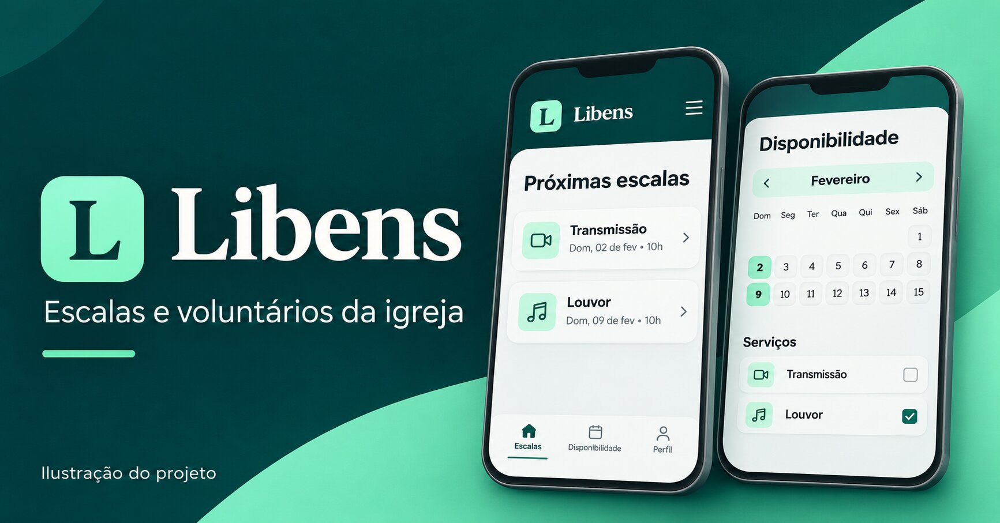

# Libens



**Aplicação web para organizar voluntários, ministérios e escalas de serviço na igreja.**

Criei o Libens a partir de uma necessidade da minha congregação. Para montar uma escala, os líderes precisam saber quem pode servir em cada data, distribuir as pessoas entre os ministérios e ajustar a equipe quando alguém precisa de uma substituição. Os voluntários, por sua vez, precisam conseguir consultar a escala atual e informar a própria disponibilidade pelo celular.

O projeto está publicado e **já está sendo implementado na congregação**. A implantação é uma oportunidade de observar como a ferramenta se encaixa na rotina dos ministérios e ajustar os fluxos conforme o uso.

[Acessar o Libens](https://pic-snapshot-creator.lovable.app/login)

## O que o Libens faz

| Perfil | Fluxos principais |
| --- | --- |
| **Servo** | Informa disponibilidade, consulta suas escalas e solicita substituição. |
| **Líder** | Organiza eventos e escalas do ministério, consulta a disponibilidade da equipe e acompanha substituições. |
| **Pastor(a)** | Acompanha as escalas, o histórico de participações e a organização dos ministérios pelo painel pastoral. |
| **Administrador** | Gerencia usuários, perfis de acesso, lideranças e ministérios. |

A criação de escalas para o mês atual parte dos eventos cadastrados e da disponibilidade informada. O sistema sugere pessoas, considera conflitos de horário e sinaliza vagas para preenchimento manual. A equipe responsável pode revisar a escala antes de confirmá-la.

A aplicação também inclui histórico de eventos, lembretes de escala, instalação como PWA e opções de tamanho da fonte. A entrega de avisos no aparelho depende de o app estar em execução. [Instalação](docs/install-mobile.md) · [Notificações](docs/notifications.md)

## Como desenvolvi

Comecei pelos fluxos da congregação: informar disponibilidade, montar e consultar escalas e lidar com substituições. Usei o **Lovable** para estruturar a aplicação e acelerar a prototipação. Usei o **Visual Studio Code** para revisar o código, ajustar a interface e validar os fluxos. Mantive o histórico de mudanças com **Git e GitHub**, sincronizado com o projeto no Lovable.

Um dos desafios foi transformar as responsabilidades da congregação em permissões da aplicação. Por exemplo, o Líder precisa gerenciar as escalas do próprio ministério, enquanto o Servo precisa consultar sua escala e solicitar substituição. As regras de acesso são verificadas no banco, além de orientar quais ações aparecem na interface.

## Ferramentas e tecnologias

| Área | Ferramentas |
| --- | --- |
| Interface | React, TypeScript, Tailwind CSS, Radix UI e Lucide |
| Rotas e dados | TanStack Start, TanStack Router e TanStack Query |
| Autenticação e banco | Supabase Auth e PostgreSQL, com políticas de acesso por linha (RLS) e migrações SQL |
| Desenvolvimento e publicação | Lovable, Visual Studio Code, Vite, Node.js e npm |
| Controle de versão e qualidade | Git, GitHub, GitHub Actions, ESLint, Prettier e PGlite |
| Experiência no celular | PWA com manifesto e service worker |

## Testes e execução local

Com Node.js 24, instale as dependências com `npm ci`. Configure `VITE_SUPABASE_URL` e `VITE_SUPABASE_PUBLISHABLE_KEY` com os valores de um projeto Supabase de desenvolvimento preparado com as migrações do repositório. Depois, execute `npm run dev`.

```bash
npm test
npm run typecheck
npm run build
```

A suíte usa dados fictícios para verificar regras de escalas, conflitos, substituições e permissões. Os testes de banco usam PGlite. O GitHub Actions executa os testes, a verificação de tipos e o build.

- [Geração de escalas mensais](docs/monthly-schedules.md)
- [Painéis, acessos e acessibilidade](docs/panels-accessibility.md)
- [Testes automatizados](tests/)
- [Verificações no GitHub Actions](.github/workflows/checks.yml)

**Desenvolvido por Caio Camelo.**
